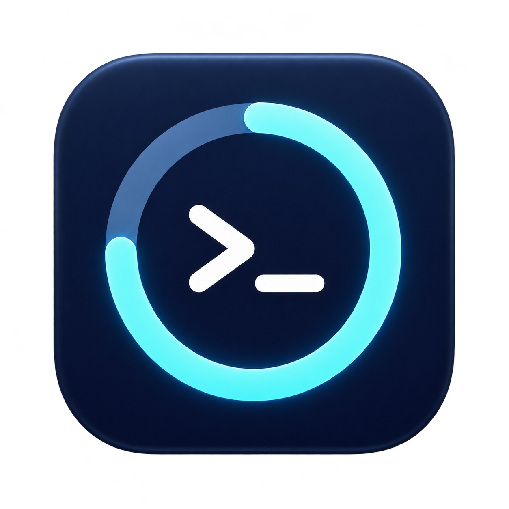
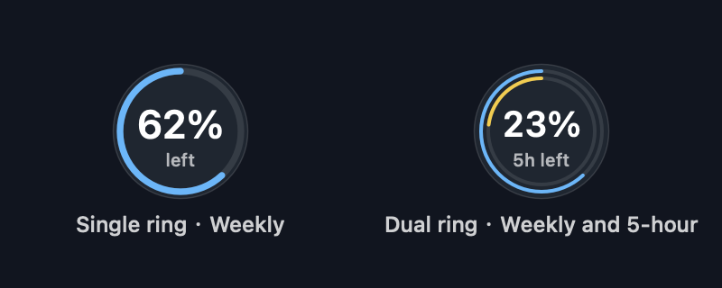
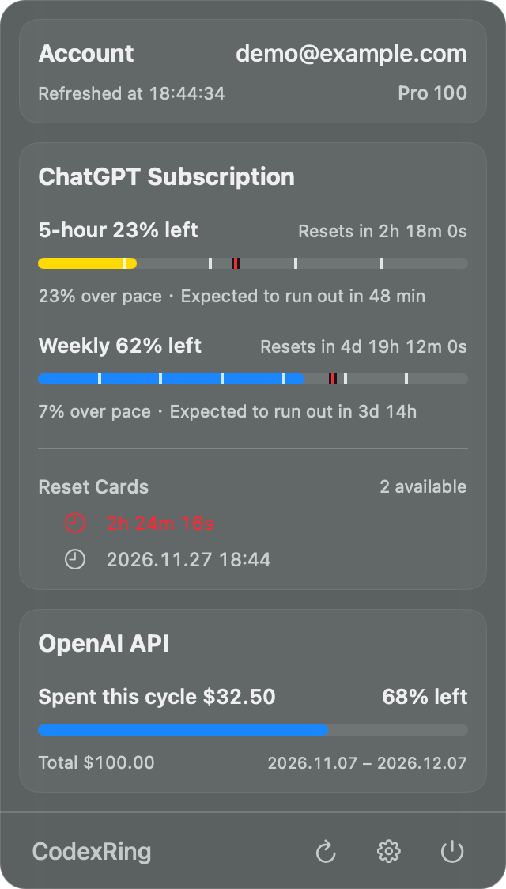
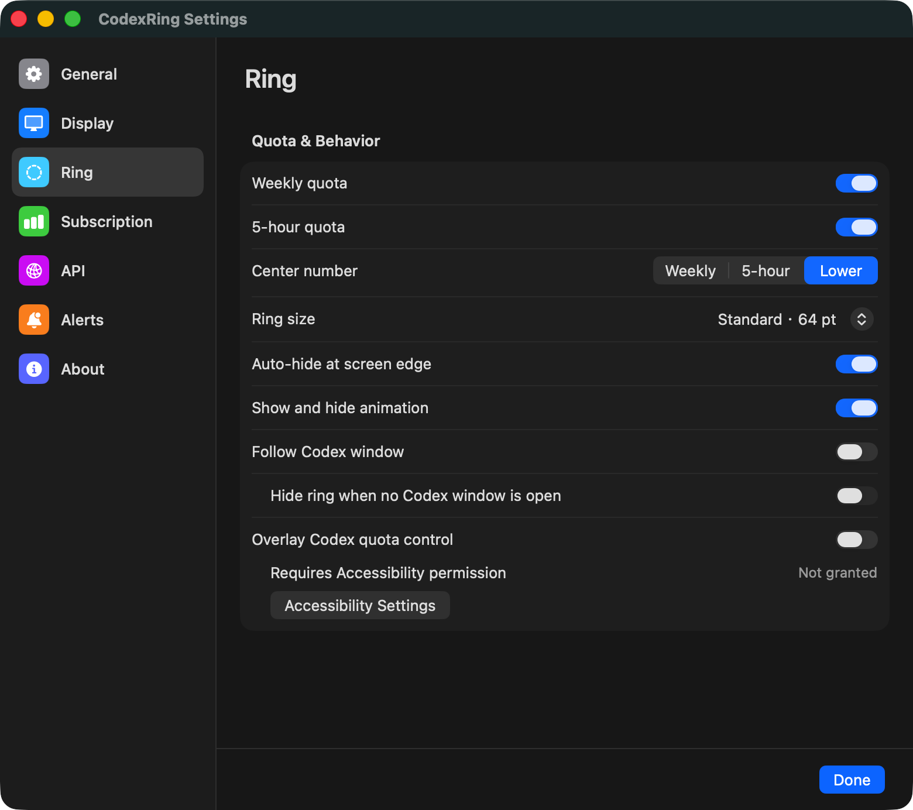
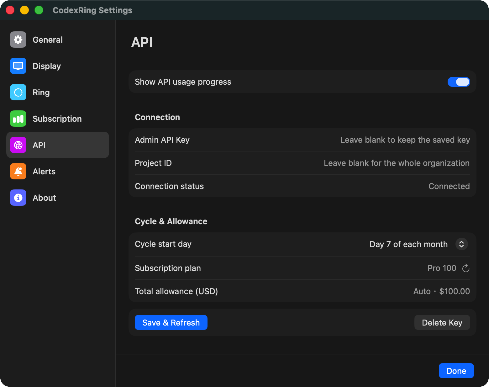
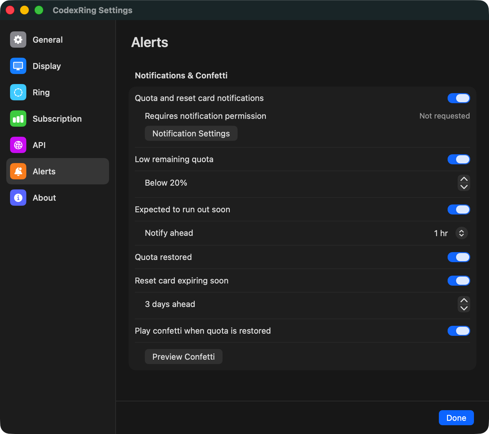

  

# CodexRing

**English** · [简体中文](README.zh-CN.md)

**Keep an eye on your Codex quota on macOS.** Check the floating ring at a glance, or open the menu bar panel for usage, reset times, and any available reset cards. The panel can also show OpenAI API costs.

CodexRing is an independent, open-source project and is not affiliated with OpenAI.

[Download the latest release](https://github.com/freezezhang/codex-ring/releases/latest) · [Install](#installation) · [Interface](#interface-guide) · [Settings](#settings-reference) · [Troubleshooting](#troubleshooting)

## Installation

1. Install the official Codex desktop app or standalone Codex CLI and sign in. The desktop app alone is sufficient. CodexRing prefers its bundled App Server when available.
2. Download one ZIP from [GitHub Releases](https://github.com/freezezhang/codex-ring/releases/latest). Check your chip in **Apple menu → About This Mac**.

   | Package suffix | Mac |
   | --- | --- |
   | `macOS-arm64.zip` | Apple silicon, such as an M-series Mac |
   | `macOS-x86_64.zip` | Intel Mac |
   | `macOS-universal.zip` | Either chip type |

3. Unzip the download, drag `CodexRing.app` into **Applications**, and open it. When upgrading, quit the current CodexRing first, then replace the app. Your settings carry over.
4. Wait for the first quota refresh. Click the CodexRing icon in the menu bar to open the panel, then click its gear icon to open Settings. You can also click the regular floating ring to open Settings.

The app targets **macOS 13.0 or later**. Your Mac also needs to meet the requirements of your Codex version. To verify the download, run `shasum -a 256 <downloaded ZIP>` and compare the result with the matching entry in `SHA256SUMS.txt`. Downloads are ad hoc signed and macOS may report that the app is not notarized. Verify the source and checksum before proceeding. [Apple’s guide to opening apps safely](https://support.apple.com/en-us/102445)

Choose where you want to see your quota.

| Goal | Setting |
| --- | --- |
| Keep a floating ring on the desktop | Leave **Display → Show ring** on and turn off both Codex window modes under **Ring**. |
| Use the menu bar only | Turn off **Show ring** and leave **Show in menu bar** on. To show the icon without percentages, also turn off **Show quota in menu bar**. |
| Keep the ring with the Codex window | Turn on **Ring → Follow Codex window**. You can also enable **Hide ring when no Codex window is open**. |
| Display CodexRing over the usage ring in the Codex sidebar | Turn on **Ring → Overlay Codex quota control** and follow the Accessibility steps below. |

## Interface guide

The screenshots show CodexRing running on macOS with sample account, quota, cost, and date values.

### Floating ring

- Under **Settings → Ring**, choose the periods you want on the floating ring. With both selected, the outer ring shows the weekly quota and the inner ring shows the 5-hour quota. The 5-hour option requires a quota window from Codex.
- With two rings, **Center number** can show **Weekly**, **5-hour**, or **Lower**. **Lower** picks an exhausted quota first, then the one forecast to run out sooner. When there is no usable forecast, it picks the lower remaining percentage.
- Under **Display → Show**, choose remaining or used. Remaining fills counterclockwise from the top and used fills clockwise. Colors always follow the share actually used. Blue indicates less than 70% used, followed by yellow at 70%, orange at 80%, and red at 90%.
- Hover for about 0.35 seconds to see the periods at a glance. Drag to move the ring. Right-click or Control-click for **Reset Info**, **Refresh Now**, **Pin Position**, **Hide Ring**, Settings, or Quit. With free movement, the ring can tuck away at a screen edge and reappear when you point at that edge.
- Choose a 26, 32, 56, 64, or 76 pt ring. The two smallest sizes show the ring and percentage. Larger sizes also show a short caption.

**Pin Position** locks mouse dragging. A pinned ring can still follow the Codex window, and overlay mode automatically locks the ring to the native control. Hiding the floating ring leaves the menu bar and refreshes available.

In free mode, the ring stays on its regular macOS desktop. It can appear over a fullscreen app and return to its previous desktop when you leave fullscreen.

### Menu bar quota panel

Click the menu bar icon to expand the panel. The percentages next to the icon follow the selected ring periods and are separated by `|` when both are selected. The expanded panel lists every quota period the account supports. You can therefore have one floating ring and two rows in the panel. If Codex reports multiple quota pools, choose one under **General** or **Subscription**.

| Section | What it shows |
| --- | --- |
| Account | The Codex sign-in email, subscription plan, and time of the last successful refresh. Hover over a truncated email to see the full address. |
| ChatGPT Subscription | Weekly and, when available, 5-hour quotas. Each row shows a percentage, a progress bar, and a reset time. The percentage follows the remaining or used setting. |
| Reset Cards | The number of available cards and any expiry times Codex returned. Cards turn yellow, orange, and red at 7 days, 3 days, and 1 day remaining. Red items show a countdown in hours, minutes, and seconds. The ring’s **Reset Info** menu also shows expiry dates. |
| OpenAI API | Current cycle costs, allowance, and percentage when API tracking is enabled and a key is configured. |
| Footer buttons | Refresh, Settings, and Quit, from left to right. Click outside the panel or press Escape to close it. |

### Reading usage pace and reset times

- The fixed ticks divide the window into days or hours. The moving marker shows the position you would reach by using quota evenly. If 40% of a window has elapsed and you have used 60%, you are 20 percentage points over pace. The marker is red when you are over pace and green when you are under. It is hidden when the difference is within two percentage points.
- The run-out forecast uses the average usage rate within the current window. Continued use, a break, or a change in the workday setting can change it. It may be absent at the start of a window or when data is missing, expired, or exhausted.
- In **Settings → Subscription**, workweek options of 4, 5, or 6 days start on Monday in your local time zone. **Auto (7 days)** uses all seven days and hides the weekly ticks. The 5-hour quota keeps its hourly scale. You can hide the fixed ticks and still show a forecast.
- A countdown reaching zero means CodexRing is waiting for a successful refresh. Reset times and cards are read from Codex. The panel provides no controls for redeeming a card or resetting quota.

### Settings window

## Settings reference

| Page | Common controls |
| --- | --- |
| General | Launch at login, interface language, and a refresh interval of 1, 2, or 5 minutes. |
| Display | Floating ring visibility, menu bar visibility, percentages, remaining or used, and system, light, or dark appearance. |
| Ring | Quota periods, center number, size, edge hiding, animation, window following, and overlay. |
| Subscription | Usage pace, workdays per week, tick style, and countdown or date and time. |
| API | Admin API key, optional project ID, monthly cycle start, and allowance. |
| Alerts | Quota and reset card notifications, plus the quota recovery confetti option and preview. |
| About | Version information. Click the app icon five times to open the debug window. |

**General → Interface language** follows macOS by default. English, Simplified Chinese, Traditional Chinese, Japanese, and Korean are available. Changing the language updates the app immediately. Subscription reset dates and reset card expiry dates use Beijing time (UTC+8).

### Following or overlaying the Codex window

| Mode | Ring position | Click behavior | Permission |
| --- | --- | --- | --- |
| Follow Codex window | Near the top right of Codex by default. Drag it anywhere within that window. | Opens CodexRing Settings | Basic following needs no permission |
| Overlay Codex quota control | A fixed 26 pt ring over the original usage ring above the avatar in the Codex sidebar | Opens the native Codex usage menu | Requires Accessibility |

#### Follow the window

1. Open the Codex desktop app and show its window on the current desktop. The CLI alone can supply quota data. Window following needs the desktop app.
2. Open **Settings → Ring** and turn on **Follow Codex window**. The ring starts near the top right, below the title bar. Drag it to choose another position within the window. CodexRing remembers that position separately from the free desktop position.
3. Move, resize, or make Codex fullscreen. The ring keeps its relative position. With several visible windows, the focused window takes priority, followed by the frontmost visible window. Edge hiding applies only to free movement.
4. Turn on **Hide ring when no Codex window is open** if you want the ring to disappear whenever Codex has no available window. The ring also hides when Codex is on another desktop or the app is hidden. With the option off, closing all Codex windows restores the free desktop position. Basic following may treat a minimized window as temporarily invisible and show the ring again when the window is restored.

#### Overlay the original usage ring

1. Expand the Codex sidebar and check that the small native usage ring above your avatar is visible.
2. In **Settings → Ring**, click **Accessibility Settings** and allow CodexRing in **System Settings → Privacy & Security → Accessibility**. Turning on the overlay switch also requests permission if needed.
3. Return to CodexRing, confirm the permission is **Granted**, then turn on **Overlay Codex quota control**. You need to enable the switch again after granting access. Overlay mode handles window following automatically and disables the separate following switch while active.
4. Once aligned, the small CodexRing ring covers the native one and stays locked in place. Click it to open the Codex usage menu. To reach CodexRing Settings, right-click the ring or use the gear in the menu bar panel.

The overlay sits over the existing control and leaves the Codex app files and control intact. With no available Codex window the overlay hides. If the window is visible but CodexRing cannot locate the control yet, it shows a regular ring in the window and resumes the overlay when the control becomes available. Check that the sidebar control is visible and hover over **Overlay status** for details. Turning off the overlay restores your previous ring size, position, and following preference.

### OpenAI API costs

View API settings screenshot

1. Turn on **Settings → API → Show API usage progress**.
2. Enter an **OpenAI Admin API key** with cost read access. Regular keys for model calls cannot query organization costs. Enter a `proj_` project ID to filter the costs or leave it blank for the organization total.
3. Set the **Cycle start day**. The monthly cycle begins at local midnight on the chosen day and uses the final day in shorter months. The day must be set manually. Leave **Total allowance (USD)** blank to use the expected allowance for a detected Pro 100, Pro 200, or Pro 500 plan, or enter a positive USD budget.
4. Click **Save & Refresh**, then open the menu bar panel. API costs refresh about every five minutes. Opening the panel can request an update, and you can also refresh manually. The upstream cost figures can be delayed.

Costs come from the OpenAI Costs API. The percentage is relative to the budget or expected allowance, for example about 68% left after spending $32.50 of a $100 allowance. The expected allowance depends on the benefit being claimed for the correct API organization and may be prorated in the first cycle. CodexRing does not verify a live balance or change any spending limit. Enter a manual budget if an allowance cannot be inferred.

The key is stored in macOS Keychain. Leave the field blank to keep a saved key or use **Delete Key** to remove it. The API section appears only when the feature is enabled and a key is configured. API spending does not affect the Codex subscription rings or menu bar percentages. If the panel shows an error or stale data, check **Connection status**, verify the key’s permission and project ID, then use **Save & Refresh**.

### Alerts, confetti, and debug mode

View alert settings screenshot

Turn on **Alerts → Quota and reset card notifications** to configure low quota, projected exhaustion, restored quota, and reset card expiry. Defaults are a 20% remaining threshold, one hour of forecast warning, and three days before card expiry. Notifications use live quota across supported periods, including those hidden from the ring. A run-out alert needs a valid forecast, and card alerts need expiry dates. Each event type is sent once per relevant period, even after restarting. macOS notification permissions and Focus settings still apply.

**Play confetti when quota is restored** is separate from notifications. Turn it on to see **Preview Confetti**. Automatic confetti requires a detected quota recovery and honors Reduce Motion.

To test the display, click the app icon five times under **About**, enable debugging, and adjust the weekly and 5-hour percentages. Turn off debugging to resume live quota queries. Demo values are temporary and do not trigger notifications or confetti.

## Troubleshooting

- **The ring shows a dash or quota is unavailable.** Check that the official Codex app or CLI is installed and signed in. If you use the desktop app, open it once and click refresh in CodexRing. A dash represents missing, loading, failed, or stale data.
- **The 5-hour quota or reset cards are missing.** These are displayed when the account’s Codex data includes them. You can still see the weekly quota when no 5-hour window is available.
- **Both the ring and the menu bar icon are hidden.** Open CodexRing again from Applications, then restore either control under **Settings → Display**.
- **The overlay stopped working after an update.** If the previous Accessibility permission is no longer valid, remove the old entry under **System Settings → Privacy & Security → Accessibility**, allow the current app, and enable the overlay again.
- **An alert did not arrive.** Check the permission status and the specific alert in **Settings → Alerts**, then review macOS Notifications and Focus. Events already reported for the current quota period do not repeat after a restart.
- **Finder shows the old icon after an update.** Confirm you have the current ZIP from the Release page. If Finder still shows a cached icon for the app in Applications, run `touch /Applications/CodexRing.app` and check Finder again.

## Data and permissions

CodexRing reads quota and display information from the official Codex App Server running on your Mac. Usage responses, account email, and subscription plan are used in memory. CodexRing does not read Codex login token files. Display preferences, ring position, and alert history are stored locally to restore your settings and avoid duplicate alerts.

| Optional feature | macOS access |
| --- | --- |
| Overlay Codex quota control | Accessibility allows CodexRing to find the usage control and open its native menu when clicked. Basic display and following work without granting it. |
| Quota and reset card alerts | Notifications are requested when you enable alerts. Confetti can be enabled independently. |
| Launch at login | CodexRing registers a macOS login item when you turn it on. If macOS asks for approval, use **General → Login Items Settings**. |
| OpenAI API costs | The Admin API key is read from macOS Keychain when API costs are queried. |

[Security policy (Chinese)](SECURITY.md)

## Building and contributing

On macOS with a Swift toolchain, run `zsh build.sh` to create `build/CodexRing.app` and `zsh test.sh` to run the test suite. Use Xcode 26 or later to compile the native macOS 26 icon resources. The developer guide covers build options, localization, tests, and the release workflow. [Developer guide (Chinese)](docs/development.md)

CodexRing is available under the [MIT License](LICENSE). See the [contribution guide](CONTRIBUTING.md) before submitting changes. Usage pacing and related features draw on CodexBar. [Third-party notices](THIRD_PARTY_NOTICES.md) · [Changelog](CHANGELOG.md)
