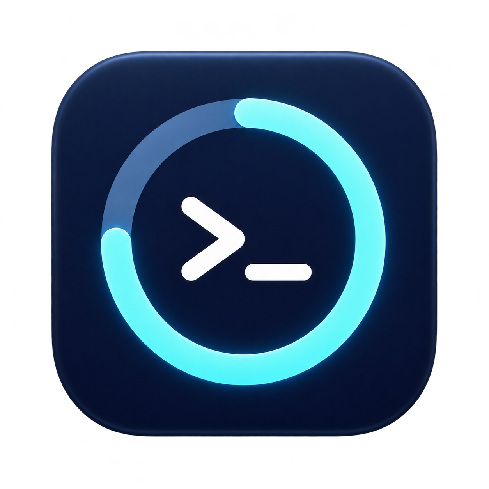
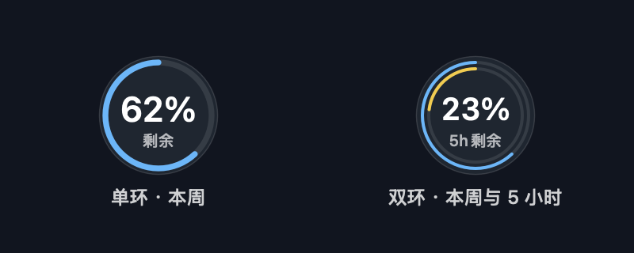
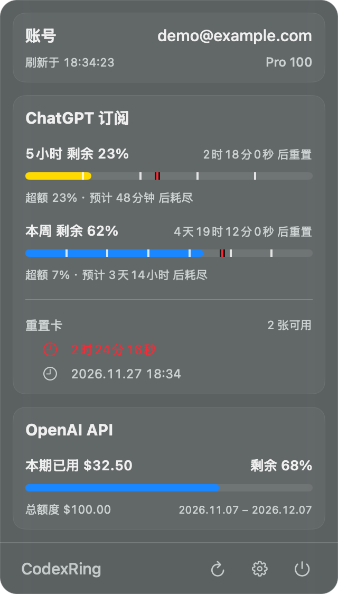
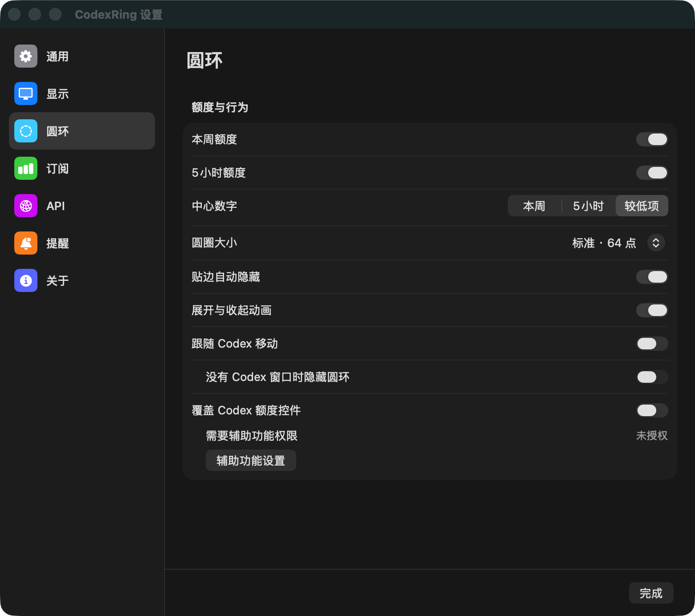
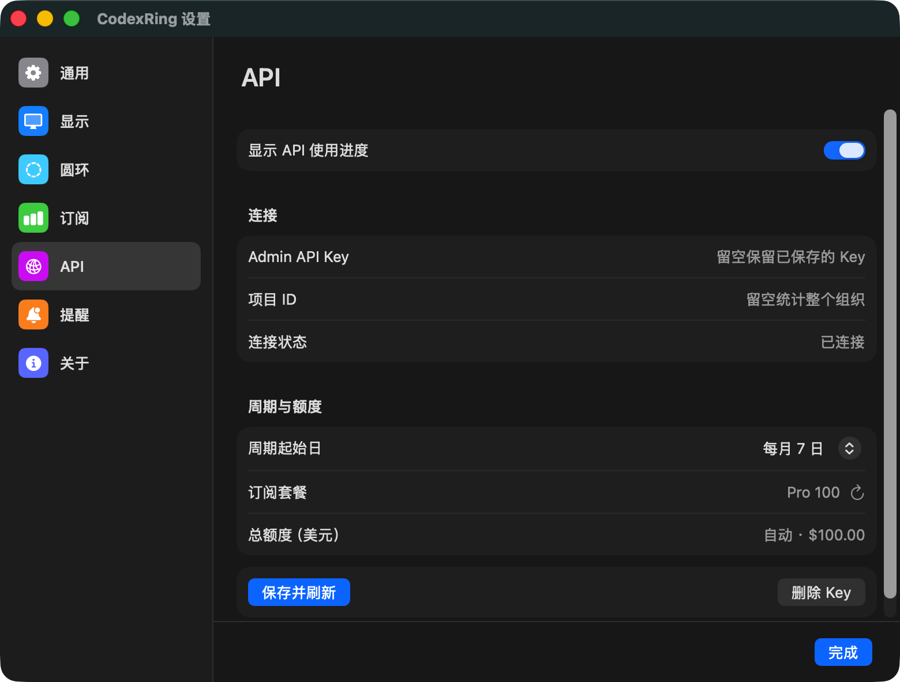
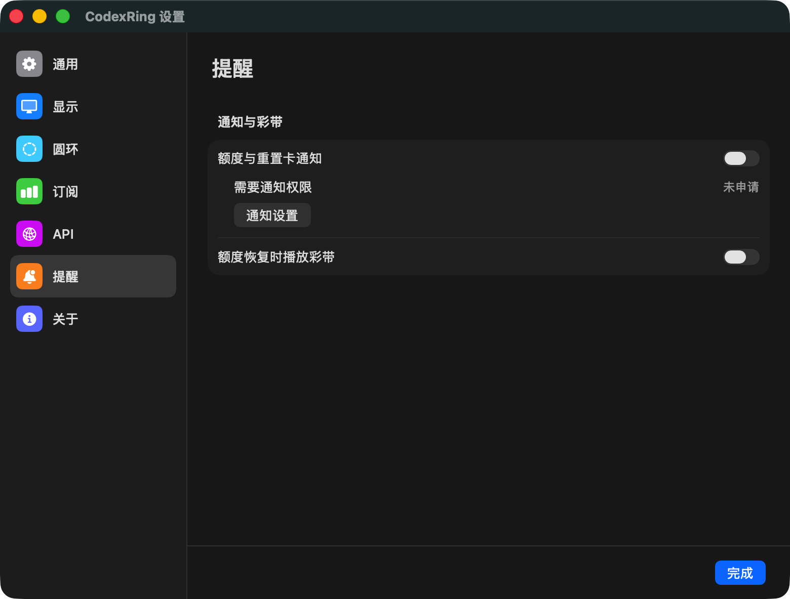

  

# CodexRing

[English](README.md) · **简体中文**

**在 Mac 上随时查看 Codex 额度。** 悬浮圆环适合快速看一眼，额度面板可以展开查看两个额度周期的进度、重置时间和重置卡。还可在同一面板里查看 OpenAI API 费用。

CodexRing 是独立的开源项目，与 OpenAI 无隶属关系。

[下载最新版](https://github.com/freezezhang/codex-ring/releases/latest) · [安装与首次使用](#安装与首次使用) · [界面说明](#界面说明) · [设置速查](#设置速查) · [常见问题](#常见问题)

## 安装与首次使用

1. 确认 Mac 已安装官方 Codex 桌面版或独立 Codex CLI，并已登录可用的账号。只安装桌面版也可以，CodexRing 优先使用桌面版内附的 App Server。
2. 从 [GitHub Releases](https://github.com/freezezhang/codex-ring/releases/latest) 下载一个 ZIP。可在苹果菜单的「关于本机」查看芯片类型。

   | 下载包 | 适用设备 |
   | --- | --- |
   | `macOS-arm64.zip` | Apple 芯片 Mac，例如 M 系列 |
   | `macOS-x86_64.zip` | Intel Mac |
   | `macOS-universal.zip` | 两种 Mac 均可使用，适合不确定芯片类型时选择 |

3. 解压后将 `CodexRing.app` 拖入「应用程序」并打开。升级时先退出当前运行的 CodexRing，再替换应用。外观、位置和 API 等设置会保留。
4. 等待首次额度刷新。点击菜单栏的 CodexRing 图标打开详情，点面板底部的齿轮进入设置。也可以从悬浮圆环的右键菜单打开设置。

应用的构建最低目标为 **macOS 13.0**，还需满足所用 Codex 版本的系统要求。自动运行测试目前覆盖 macOS 26 上的 Intel 和 Apple 芯片。Release 提供 `SHA256SUMS.txt`，可用 `shasum -a 256 <下载的 ZIP>` 算出校验值并对照。下载包的公证状态见 Release 说明。采用 ad-hoc 签名的版本首次打开时，可能受到 macOS 安全检查限制。确认下载来源和校验值后，可参考 [Apple 的安全打开说明](https://support.apple.com/zh-cn/102445)。

启动后可按自己的使用方式选择入口。

| 想怎么查看额度 | 在哪里设置 |
| --- | --- |
| 圆环浮在桌面上 | 保持「显示 → 圆环显示」开启，关闭「跟随 Codex 移动」和「覆盖 Codex 额度控件」。 |
| 只用菜单栏 | 关闭「圆环显示」，保留「菜单栏显示」。如果只想留图标，再关闭「菜单栏显示额度」。 |
| 圆环只在 Codex 窗口附近显示 | 开启「圆环 → 跟随 Codex 移动」。可另开「没有 Codex 窗口时隐藏圆环」。 |
| 用 CodexRing 的外观显示侧栏原生额度圆环 | 开启「圆环 → 覆盖 Codex 额度控件」，按下文授予辅助功能权限。 |

## 界面说明

以下截图来自 macOS 上运行的 CodexRing 界面。账号、金额、额度和日期均为演示数据。

### 桌面悬浮圆环

- 在「设置 → 圆环」选择**单环或双环**需要显示的周期。双环时外圈是本周，内圈是 5 小时。只有 Codex 返回 5 小时窗口时才可选这一项。
- 双环的**中心数字**可固定显示「本周」或「5小时」，也可选「较低项」。较低项优先显示已耗尽或预计更早耗尽的周期，无法预测时显示剩余比例更低的周期。
- 在「设置 → 显示 → 显示项」切换剩余和已用。剩余从顶部逆时针绘制，已用从顶部顺时针绘制。**颜色始终按实际已用比例变化**，低于 70% 为蓝色，达到 70%、80%、90% 时分别变为黄色、橙色、红色。
- 左键点击普通圆环，可在圆环旁展开或收起订阅和 OpenAI API 用量。
- **悬停**约 0.35 秒显示各周期额度，**拖动**可以调整位置。右键或 Control 点按可以立即刷新、固定位置、隐藏圆环、打开设置或退出。自由移动时可开启贴边自动收起，移回边缘展开。
- **显示尺寸**可选 26、32、56、64 或 76 点。26、32 点显示环和百分比，较大的尺寸还会显示简短文字。

「固定位置」只锁住鼠标拖动。圆环跟随窗口时仍会随窗口移动，覆盖时位置由原生控件决定。隐藏浮环也不会停止菜单栏或额度刷新。

自由移动时，圆环保留在原来的 macOS 普通桌面。进入其他应用的全屏空间时也可显示，退出全屏后会回到原来的桌面。

### 菜单栏额度面板

点击菜单栏图标展开。图标旁的百分比跟随圆环选中的周期，两个周期同时显示时以 `|` 分隔。面板会列出账户实际支持的额度周期。

| 区域 | 如何看 |
| --- | --- |
| 账号 | 当前 Codex 登录邮箱、订阅套餐和最近一次成功刷新时间。长邮箱会缩短，悬停可查看完整地址。 |
| ChatGPT 订阅 | 显示本周及适用时的 5 小时额度。每行有百分比、进度条和重置时间。百分比方向跟随「显示项」。 |
| 重置卡 | 有可用卡时显示数量和到期时间。进入 7 天、3 天、1 天时分别显示黄、橙、红色。红色项显示时、分、秒倒计时。 |
| OpenAI API | 开启并配置 Admin API Key 后显示，单独列出本期费用、周期、总额度和使用比例。 |
| 底部按钮 | 从左到右为立即刷新、打开设置、退出。点击面板外部或按 Esc 可收起。 |

### 怎么理解用量节奏和重置

- 进度条上的固定刻度把周期分成天或小时。移动的短线表示均匀用量对应的位置。比如周期已经过去 40%，实际用掉 60%，就会显示「超额 20%」，这里的 20% 是百分点差。少于均匀用量时显示绿色余量，差值在 2 个百分点以内时不画短线。
- 「预计耗尽」按本周期的平均速度估算。继续使用、暂停或改变工作日设定都会改变结果。周期刚开始、重置时间缺失、额度已耗尽或数据过期时，可能没有预测。
- 「设置 → 订阅 → 每周工作日」里的 4、5、6 天从周一起按本机时区计算。选择「自动」时仍按完整 7 天计算，只隐藏每周日刻度。5 小时周期始终按小时计算。白色刻度可以单独隐藏，用量预测可继续显示。
- 重置倒计时到零后会等待下次成功查询。CodexRing 只显示服务返回的时间和卡片，无法在面板中兑换重置卡或主动重置额度。

圆环和菜单栏图标旁的数字由「圆环」页所选周期决定。面板展开后会把账户支持的周期都列出来，因此面板有两行、圆环只有一圈也属正常。如果接口提供了多个额度池，可在「通用」或「订阅」里切换「额度池」。

### 设置窗口

## 设置速查

| 页面 | 常用选项 |
| --- | --- |
| 通用 | 登录时启动、界面语言、刷新间隔和当前额度状态。刷新间隔可选 1、2、5 分钟。 |
| 显示 | 分别控制桌面圆环、菜单栏图标及图标旁的额度百分比。可选剩余／已用、跟随系统／浅色／深色主题。 |
| 圆环 | 额度周期、中心数字、大小、贴边隐藏、展开与收起动画，以及跟随或覆盖 Codex 窗口。 |
| 订阅 | 用量节奏、每周工作日、周期刻度和重置倒计时／日期时间。 |
| API | 配置 OpenAI Admin API Key、项目、每月统计起始日和总额度。 |
| 提醒 | 配置额度及重置卡通知，另可开启和预览额度恢复彩带。 |
| 关于 | 查看版本、检查更新和配置自动更新。连续点击应用图标 5 次可打开调试窗口。 |

从 GitHub Releases 手动安装 0.8.0 或更新版本后，即可在「设置 → 关于」手动检查更新或开启自动检查。开启自动检查后，还可选择自动安装。

界面支持 English、简体中文、繁體中文、日本語和 한국어。「通用 → 界面语言」默认跟随系统，切换后立即应用。订阅重置及卡片绝对日期使用北京时间。

### 跟随和覆盖 Codex

| 模式 | 圆环位置 | 左键点击 | 系统授权 |
| --- | --- | --- | --- |
| 跟随 Codex 移动 | 默认在 Codex 窗口右上方，可在窗口内拖动 | 展开或收起 CodexRing 额度面板 | 基本跟随无需授权 |
| 覆盖 Codex 额度控件 | 缩为 26 点，覆盖 Codex 侧栏头像上方原来的小圆环 | 打开 Codex 原生用量菜单 | 需要辅助功能权限 |

#### 让圆环跟随窗口

1. 打开 Codex 桌面版，让它的窗口出现在当前桌面。只用 CLI 时仍可查询额度，窗口跟随需要桌面版。
2. 进入「设置 → 圆环」，开启「跟随 Codex 移动」。第一次默认在右上方并避开标题栏。可拖到窗口内其他位置，应用会独立记住跟随位置和自由桌面位置。
3. 移动、缩放或全屏显示 Codex，圆环会保持在窗口内的相对位置。多个窗口可见时优先跟随当前桌面的焦点窗口，其次跟随前面的可见窗口。贴边自动隐藏只用于自由移动模式。
4. 如果希望 Codex 不在场时也看不到圆环，开启「没有 Codex 窗口时隐藏圆环」。Codex 只在其他桌面或其应用窗口被隐藏时，圆环会跟着隐藏。全部窗口关闭后，普通跟随在该开关关闭时回到自由位置。基本模式下，最小化有时只能判断为不可见，圆环会先隐藏，恢复窗口后再出现。

#### 覆盖 Codex 自带的用量圆环

1. 展开 Codex 侧栏，确认头像上方的原生用量圆环可见。
2. 在「设置 → 圆环」点「辅助功能设置」，在 macOS「隐私与安全性 → 辅助功能」允许当前的 CodexRing。也可以直接开启覆盖开关触发系统授权提示。
3. 回到 CodexRing，确认权限显示「已授权」，再开启「覆盖 Codex 额度控件」。授权完成后需要手动重新打开开关。覆盖会自动跟随 Codex，单独的跟随开关此时不可调整。
4. 对齐成功时，CodexRing 小圆环会盖在原生圆环上，位置自动固定。左键仍由 Codex 打开自己的用量菜单。要改 CodexRing 设置，可右键圆环或用独立的菜单栏面板。

覆盖只在窗口上方显示，不改动 Codex 的界面文件或原生控件。没有可用的 Codex 窗口时，覆盖圆环会隐藏。窗口可见但暂时找不到控件时，应用会先在窗口内显示普通圆环，提示原因并继续定位，找到后自动恢复覆盖。可以先检查头像上方的控件是否可见，再在「覆盖状态」上悬停查看原因。关闭覆盖会恢复之前的尺寸、位置和跟随设置。

### OpenAI API 费用

查看 API 设置截图

1. 打开「设置 → API → 显示 API 使用进度」。
2. 填入能查询费用的 **OpenAI Admin API Key**。普通模型调用 Key 无法查询组织费用。可填写 `proj_` 开头的项目 ID，留空会统计整个组织。
3. 选择「周期起始日」。统计从每月指定日的本地零点开始，短月份会取月底。留空「总额度（美元）」时，应用会尝试按识别出的 Pro 100、Pro 200、Pro 500 套餐设置预期额度。也可手动填写预算。
4. 点击「保存并刷新」，然后在额度面板查看费用。API 费用约每 5 分钟刷新，打开面板或手动刷新也可更新，官方统计可能延迟。

费用来自 OpenAI Costs API，比例以设置的预算或预期额度为基准。例如本期已用 $32.50、总额度 $100，切到「剩余」时约显示 68%。这是按参考额度算出的比例。预期额度受实际福利领取、API 组织关联及首期折算影响，应用既不核实实时余额，也不修改支出限制。没有可识别的额度时可手动设置预算。

Key 只保存在本机钥匙串，留空保留已保存的 Key，可用「删除 Key」移除。API 区块仅在开启显示并配置 Key 后出现，费用不会计入 Codex 订阅圆环或菜单栏百分比。如果面板显示失败或过期状态，先在「API → 连接状态」检查查询权限、项目和 Key，再点「保存并刷新」。统计窗口按手动选择的起始日计算，不会自动读取订阅扣款日。

### 提醒与彩带

查看提醒设置截图

在「设置 → 提醒」开启「额度与重置卡通知」后，可分别配置剩余额度不足、预计即将耗尽、额度恢复和重置卡过期。默认低额度阈值为 20%，预计耗尽提醒提前 1 小时，重置卡提醒提前 3 天。通知按真实额度刷新检查，同一周期同类事件只提醒一次。首次开启时按 macOS 提示授权，是否弹出仍取决于系统通知和专注模式。

「额度恢复时播放彩带」可单独开启，并用「预览彩带」查看效果。检测到实际额度恢复时才触发，遵守系统「减少动态效果」设置。通知会检查账户提供的额度周期，无需把所有周期都显示在圆环里。预计耗尽提醒依赖当前周期的有效预测，重置卡提醒只在系统提供到期时间时触发。

需要试验显示效果时，到「关于」连续点击应用图标 5 次，启用调试并调整本周或 5 小时的使用比例。关掉「启用调试」开关后恢复真实额度查询，模拟值不保存，也不会触发通知或彩带。

## 常见问题

- **圆环显示「—」或面板提示无法读取额度**。先确认本机官方 Codex 已登录，再点菜单栏的刷新按钮。如果只安装了桌面版，尝试打开一次 Codex 后再刷新。无有效数据时显示状态和横线，避免把加载、失败或过期误读为余额为零。
- **看不到 5 小时额度或重置卡**。这两部分依照 Codex 接口实际返回内容显示。账户没有提供 5 小时窗口时，仍可查看本周额度。
- **圆环和菜单栏图标都隐藏了**。从「应用程序」再次打开 CodexRing，然后到「设置 → 显示」恢复任一入口。
- **更新后覆盖失效**。如设置提示旧辅助功能授权可能失效，在 macOS「系统设置 → 隐私与安全性 → 辅助功能」移除旧授权，重新授权当前应用，再打开覆盖开关。
- **开启了提醒却没有通知**。先看「提醒」页的授权状态和对应事件开关，再检查 macOS 的通知与专注模式。同一周期的同类通知只发送一次，应用重启也会记住已提醒的事件。
- **更新后 Finder 仍显示旧图标**。确认下载的是 Release 当前提供的 ZIP。如果安装到「应用程序」后仍看到缓存的旧图标，可在终端运行 `touch /Applications/CodexRing.app` 刷新应用目录的修改时间，再到 Finder 查看。

## 数据与权限

CodexRing 使用本机官方 Codex App Server 读取额度和账号显示信息。额度响应、账号邮箱和套餐仅在内存中使用，应用不读取 Codex 登录令牌文件。外观、位置和提醒去重记录保存在本机，便于恢复设置并避免重复提醒。

| 可选功能 | 使用的系统权限或服务 |
| --- | --- |
| 覆盖 Codex 额度控件 | 辅助功能用于查找原生用量控件，并在点击时打开原生菜单。常规显示和基本窗口跟随无需授权。 |
| 额度与重置卡提醒 | 开启提醒时申请通知权限。彩带可以单独开启。 |
| 登录时启动 | 打开开关时登记 macOS 登录项。系统需要批准时，从「通用 → 登录项设置」进入。 |
| OpenAI API 费用 | 查询费用时从本机钥匙串读取 Admin API Key。 |

更多数据边界和漏洞报告方式见 [安全说明](SECURITY.zh-CN.md)。

## 构建与贡献

在 macOS 上准备 Swift 工具链，运行 `zsh build.sh` 得到 `build/CodexRing.app`，运行 `zsh test.sh` 执行单元测试。对于 macOS 26 的原生图标构建，使用 Xcode 26 或更新版本。完整开发、测试、本地化及 Release 流程见 [开发说明](docs/development.md)。

采用 [MIT 许可证](LICENSE)。欢迎提交变更，请先阅读 [贡献指南](CONTRIBUTING.zh-CN.md)。用量节奏等功能参考了 CodexBar，详见 [第三方声明](THIRD_PARTY_NOTICES.md)。历史版本改动见 [更新记录](CHANGELOG.md)。
